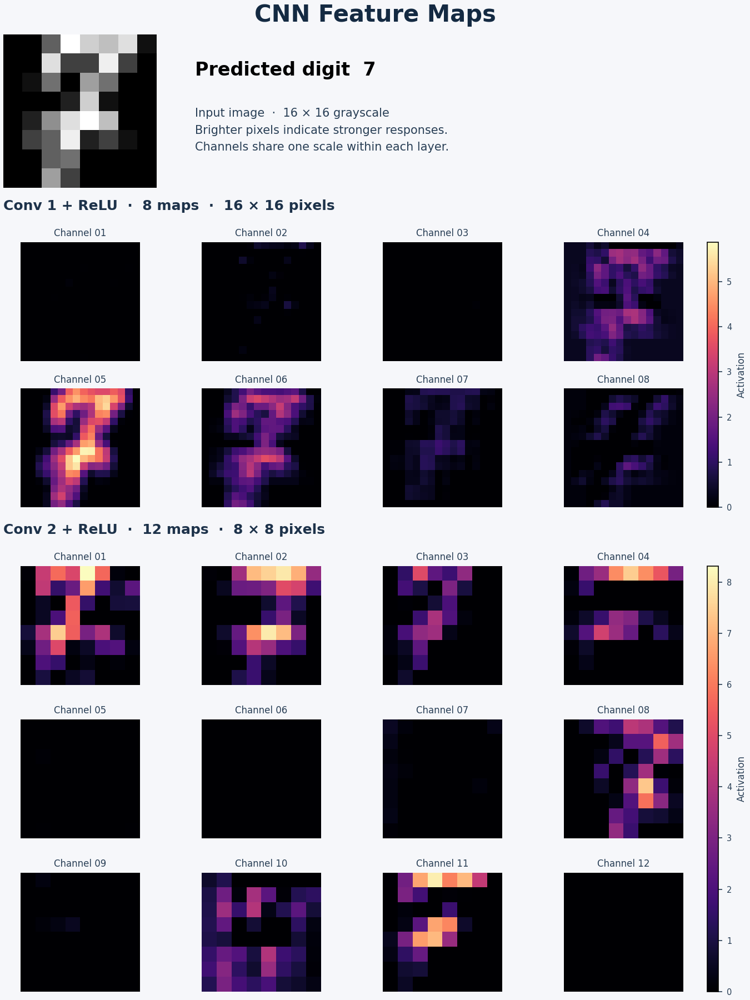

# Problem Solving Activity 9

**Module 5 · Deep Learning for Computer Vision**  
**Title · Visualise Feature Maps from a Convolutional Neural Network**

**Name:** ____________________  
**USN / Roll number:** ____________________  
**Date:** ____________________

## Problem statement

A CNN transforms an image into several feature maps before producing a class
prediction. Visualise the intermediate maps from two convolutional layers and
describe how the response to the same input changes with depth.

## Aim

Train a handwritten-digit CNN, capture the activation tensor after each
convolution and ReLU, and compare the individual channels as heatmaps.

## Tools and input

- Python 3.9+, NumPy, Pillow and Matplotlib for visualisation.
- scikit-learn for optional retraining. It supplies 1,797 grayscale digit
  images through `load_digits()` from the UCI Optical Recognition of
  Handwritten Digits dataset.
- The bundled input is a held-out image of the digit **7**. Training inputs
  start at 8 × 8 and are enlarged to 16 × 16 by repeating each pixel in both
  directions. Pixel values are scaled to the interval [0, 1].

## Theory and architecture

A convolutional filter applies the same learned weights to each local input
patch. Each output channel holds the spatial response for one filter. ReLU
keeps positive responses and sets negative responses to zero. Average
pooling replaces each nonoverlapping 2 × 2 region with its mean, reducing
the spatial size by half. Conv 2 receives the pooled responses from Conv 1
and can combine patterns across its eight input channels.

| Stage | Configuration | Output per image |
| --- | --- | --- |
| Input | Grayscale | 16 × 16 × 1 |
| Conv 1 + ReLU | 8 filters, 3 × 3, stride 1, padding 1 | 16 × 16 × 8 |
| Average pool | 2 × 2, stride 2 | 8 × 8 × 8 |
| Conv 2 + ReLU | 12 filters, 3 × 3, stride 1, padding 1 | 8 × 8 × 12 |
| Average pool | 2 × 2, stride 2 | 4 × 4 × 12 |
| Flatten and dense | 192 features mapped to 10 digit scores | 10 logits |

## Algorithm

1. Split the digit dataset into 1,437 training images and 360 test images
   using a stratified 80/20 split with seed 42.
2. Train the CNN for 25 epochs using mini-batch gradient descent and softmax
   cross-entropy. Save the learned weights and record held-out accuracy.
3. Load the supplied image and saved weights. Run a forward pass and use
   the index of the highest logit as the predicted digit.
4. Take the output after ReLU in each convolutional layer. Plot each channel
   as a heatmap with a shared scale for the channels of that layer.
5. Compare the spatial detail, strong responses, and low-response channels.

## Run the activity

Extract the ZIP and open a terminal in its project folder. On macOS or Linux:

```bash
python3 -m pip install -r requirements.txt
python3 visualize.py
```

On Windows, use `py` in place of `python3`. Open
[`results/feature_maps.png`](results/feature_maps.png) after running the
program. The ZIP already includes the sample image, trained weights and
generated result.

Try a tightly cropped image of another handwritten digit. Use `--invert`
for dark ink on a light background. The model expects light strokes on
a dark background.

```bash
python3 visualize.py --image my_digit.png --invert --output results/my_digit_maps.png
```

To rebuild the weights and the result:

```bash
python3 -m pip install -r requirements-training.txt
python3 train.py
python3 visualize.py
```

## Result and observations



| Measurement | Recorded result |
| --- | --- |
| Held-out classification accuracy | 340 of 360 correct (94.44%) |
| Sample prediction | 7, matching the supplied label |
| Conv 1 + ReLU | 8 maps of 16 × 16 pixels each |
| Conv 2 + ReLU | 12 maps of 8 × 8 pixels each |

- Conv 1 channel 5 strongly follows the top bar and diagonal stroke of the
  sampled digit. Other channels respond more weakly to that same image.
- Conv 2 channel 4 responds most strongly around the top bar, while channel
  8 highlights part of the descending stroke. The maps are visibly coarser
  because Conv 2 receives the 8 × 8 output of the first pooling step.
- Brighter pixels represent stronger filter responses. To compare intensity
  across layers, read the numerical colour bars because the layers use
  different display ranges. Channel interpretations here are observations for
  this sample.

## Conclusion

The CNN predicted the digit correctly and produced 20 intermediate maps.
The first convolutional layer retained finer spatial detail. The second layer
combined the pooled first-layer responses into coarser maps that highlighted
different regions of the digit.

## Viva questions

1. **Why are Conv 1 maps 16 × 16?** A 3 × 3 filter with stride 1 and one pixel
   of padding on each side preserves the spatial dimensions.
2. **Why does Conv 2 yield 12 maps?** It has 12 learned filters. Each filter
   combines all eight input channels and produces one output map.
3. **Why are some channel tiles dark?** Their activations are small relative
   to the layer's display scale, and ReLU maps negative responses to zero.

## File guide

| File | Contents |
| --- | --- |
| `cnn.py` | Convolution, ReLU, pooling, classifier and backpropagation |
| `train.py` | Dataset split, model training and test-set evaluation |
| `visualize.py` | Image preprocessing, inference and heatmap generation |
| `assets/sample_digit.png` | Held-out digit image |
| `assets/weights.npz` | Trained model parameters |
| `results/feature_maps.png` | Input and all 20 activation maps |
| `results/training_summary.json` | Training settings, loss values and held-out accuracy |
